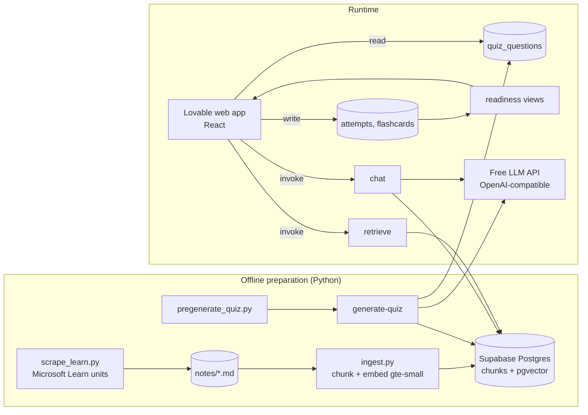

# AZ-900 Study Buddy (Unofficial)

> An AI-powered exam-prep app for **Microsoft Azure Fundamentals (AZ-900)**, grounded in the public Microsoft Learn course notes using **Retrieval-Augmented Generation (RAG)**.
> Built for the **#1MillionDevs Vibe Coding Hackathon: AZ-900 Exam Prep Edition**.

**Live demo:** https://az-900.lovable.app
**Demo video:** _add link here_
**Pitch deck:** https://canva.link/o1g1ti1ealprc7m

> ⚠️ **Unofficial study tool.** This project is not affiliated with, endorsed by, or sponsored by Microsoft. It contains **no real exam questions** and uses no Microsoft logos. All questions are original and generated from public Microsoft Learn course content.

---

## Table of contents

1. [The problem](#the-problem)
2. [What it does](#what-it-does)
3. [Hackathon tracks covered](#hackathon-tracks-covered)
4. [How it works (architecture)](#how-it-works-architecture)
5. [The RAG pipeline](#the-rag-pipeline)
6. [Prompt engineering](#prompt-engineering)
7. [Tech stack](#tech-stack)
8. [Repository structure](#repository-structure)
9. [Database schema](#database-schema)
10. [Setup guide](#setup-guide)
11. [Environment variables and secrets](#environment-variables-and-secrets)
12. [Running cost: zero by design](#running-cost-zero-by-design)
13. [Responsible use and limitations](#responsible-use-and-limitations)
14. [Roadmap](#roadmap)
15. [Data sources and attribution](#data-sources-and-attribution)
16. [Author](#author)

---

## The problem

Learners preparing for AZ-900 face four recurring pain points:

- Practice questions tell you *what* the answer is, but not *why* it is right or the other options are wrong.
- Azure terms and services are easy to forget and easy to confuse (IaaS vs PaaS vs SaaS, regions vs availability zones, and so on).
- Cloud concepts feel abstract to beginners, especially without examples from their own context.
- Learners rarely know whether they are actually ready to sit the exam.

## What it does

| Feature | Description |
|---|---|
| **Smart Quiz** | Choose a domain and topic, then answer original multiple-choice questions. Every answer gives instant feedback, an explanation of why the right answer is right, and why **each** wrong option is wrong. |
| **Flashcard Coach** | Questions you get wrong become flashcards automatically. Cards use SM-2 style spaced repetition, and the ones you keep missing come up first. |
| **AI Study Buddy** | A RAG chat that answers only from the course notes, in simple language. Switch between **Simple**, **African example** (analogies such as M-Pesa, SACCOs and matatus) and **Kiswahili**. Every answer shows **source chips** linking back to the original Microsoft Learn unit. |
| **Readiness Tracker** | A dashboard with an overall readiness ring, per-domain progress bars, a radar chart, and a **Weak spots** list with a "Practice this" button. |
| **Weak-spot loop** | Missing quiz questions creates flashcards and updates the readiness dashboard, so the four features reinforce each other. |

Learners are signed in anonymously, so there is no sign-up friction and each learner's attempts and flashcards stay private.

## Hackathon tracks covered

| Track | Challenge | Where in the project |
|---|---|---|
| 📝 Practice & Assessment | Smart Quiz Builder with explanations, organised by topic | Quiz screen + `generate-quiz` function |
| 🧠 Memory & Revision | Flashcard Coach that focuses on weak concepts | Flashcards screen (SM-2 fields in `flashcards` table) |
| 🤖 Support | AI Study Buddy with African examples or local languages | Study Buddy screen + `chat` function |
| 📊 Progress | Readiness dashboard by topic | Readiness screen + `readiness_by_*` SQL views |

## How it works (architecture)



**Design choices**

- **Everything in one database.** Supabase Postgres holds the notes, vectors, quiz bank, attempts and flashcards, using the `pgvector` extension for similarity search.
- **Pre-generated quiz bank.** Questions are generated ahead of time and stored, so quizzes load instantly and use no live LLM calls. Only the Study Buddy chat calls the LLM live.
- **Provider-agnostic LLM layer.** The edge functions call any OpenAI-compatible endpoint, so the model or provider is changed with secrets only, with no code change.
- **Security by design.** The browser only holds the public anon key. Row Level Security limits each learner to their own attempts and flashcards.

## The RAG pipeline

1. **Collect.** `scrape_learn.py` reads the AZ-900 certification page, finds its three learning paths, and saves each unit as Markdown (3 paths: cloud concepts, architecture and services, management and governance).
2. **Chunk.** `ingest.py` strips front matter and includes, splits by heading, and keeps chunks to about 1,800 characters. The nearest heading is prepended to each chunk to keep its context.
3. **Tag.** Each chunk gets an AZ-900 domain (`cloud_concepts`, `architecture_services`, `management_governance`) from its learning path.
4. **Embed.** Chunks are embedded locally with **gte-small** (384 dimensions, normalised). Supabase Edge Functions use the same model, so query vectors and stored vectors match.
5. **Store.** Chunks and vectors go into the `chunks` table with an HNSW cosine index.
6. **Retrieve.** At query time the question is embedded and the SQL function `match_chunks()` returns the top matches, optionally filtered by domain.
7. **Generate.** The retrieved chunks are placed in the prompt as the only allowed source of facts, and the LLM answers or writes questions from them.

The ingested corpus is **317 chunks** (56 cloud concepts, 180 architecture and services, 81 management and governance).

## Prompt engineering

All prompts live in [`supabase/functions/_shared/prompts.ts`](supabase/functions/_shared/prompts.ts). Every prompt uses the same five blocks:

| Block | Purpose |
|---|---|
| **Role** | Sets the persona: an unofficial AZ-900 tutor for beginners. |
| **Rules** | Grounding and safety: use only the context, write original questions, no "all of the above", spread correct answers across A-D. |
| **Context** | Retrieved chunks, each labelled `[CHUNK id]` so a question can cite its source. |
| **Task** | What to produce: topic, difficulty and number of questions. |
| **Output schema** | Strict JSON so the app can parse and store the result. |

**Quiz prompt** (`generate-quiz`)
- Forces exactly four options and one correct answer.
- Requires a `why_correct` explanation and a `why_wrong` explanation for every wrong option. This directly targets the "I don't understand why" pain point.
- Wrong options must be plausible: real Azure terms or common beginner misconceptions.
- Difficulty is defined in the prompt: easy is definition recall, medium is telling similar services apart, hard is scenario-based service selection.
- The function **validates the model's JSON** (four options, valid correct letter, explanations present, valid source chunk) and silently drops any question that breaks the rules.

**Study Buddy prompt** (`chat`)
- Answers only from the retrieved notes. If the notes do not cover the question, it says so and labels any general guidance as such, which limits hallucination.
- Keeps answers short and ends with a question that checks understanding.
- Style is switched by mode: **simple**, **African example** (a short everyday analogy while facts stay grounded in the notes) or **Kiswahili** (Azure terms kept in English).

## Tech stack

| Layer | Technology |
|---|---|
| Frontend | React web app generated with [Lovable](https://lovable.dev), Markdown rendering for chat |
| Backend | [Supabase](https://supabase.com): Postgres, `pgvector`, Auth (anonymous sign-in), Row Level Security, Edge Functions (Deno / TypeScript) |
| Embeddings | `gte-small` (384-dim), local via `sentence-transformers` for ingestion and built-in `Supabase.ai.Session` in Edge Functions |
| LLM | Any OpenAI-compatible API. Default: Groq free tier with `openai/gpt-oss-120b`. Configurable through secrets |
| Data pipeline | Python 3: `requests`, `beautifulsoup4`, `markdownify`, `sentence-transformers`, `supabase-py` |
| AI-assisted build | Lovable, Claude (prompt design and code assistance) |

## Repository structure

```
az900-study-app/
├── README.md
├── schema.sql                     # tables, pgvector index, match_chunks(), views, RLS
├── scrape_learn.py                # Microsoft Learn -> Markdown notes
├── ingest.py                      # chunk + embed + load into Supabase
├── pregenerate_quiz.py            # fill the quiz bank via the generate-quiz function
├── LOVABLE_PROMPT.md              # the prompt used to generate the frontend
├── requirements.txt
├── .env.example
└── supabase/
    └── functions/
        ├── _shared/prompts.ts     # all prompt templates
        ├── retrieve/index.ts      # embed query -> top-k chunks
        ├── generate-quiz/index.ts # RAG + LLM -> validated questions -> DB
        └── chat/index.ts          # RAG + LLM Study Buddy with sources
```

The `notes/` folder (scraped course content) is **not committed**. Run the scraper to recreate it.

## Database schema

Defined in [`schema.sql`](schema.sql).

| Object | Purpose |
|---|---|
| `chunks` | Note chunks with `embedding vector(384)`, module, unit, heading, source URL, domain |
| `match_chunks()` | SQL function for cosine-similarity search with an optional domain filter |
| `all_notes` (view) | The whole course in reading order |
| `quiz_questions` | Pre-generated questions: options, correct letter, `why_correct`, `why_wrong`, source chunk |
| `attempts` | One row per answer (user, topic, domain, correct or not) |
| `flashcards` | Cards with SM-2 fields: `ease`, `interval_days`, `repetitions`, `due_at`, `lapses` |
| `readiness_by_topic`, `readiness_by_domain` (views) | Accuracy per topic and domain, which feeds the dashboard |

Row Level Security: notes and questions are publicly readable. Attempts and flashcards are readable and writable only by their owner.

## Setup guide

### Prerequisites
- Python 3.10+
- Node.js (LTS) for the Supabase CLI
- A free [Supabase](https://supabase.com) account
- A free LLM API key (for example [Groq](https://console.groq.com))

### 1. Create the Supabase project and database
1. Create a new Supabase project.
2. Open **SQL Editor**, paste the contents of `schema.sql`, and run it.
3. Go to **Authentication, then Sign In / Providers** and enable **Allow anonymous sign-ins**.

### 2. Configure local environment
```bash
git clone <this-repo>
cd az900-study-app
cp .env.example .env        # Windows: copy .env.example .env
```
Fill in `.env` with your Supabase **Project URL** and **service_role** key (used only by local scripts).

```bash
pip install -r requirements.txt
```

### 3. Collect and ingest the notes
```bash
python scrape_learn.py
python ingest.py notes --base-url https://learn.microsoft.com/en-us/training/modules
```
Verify in the SQL Editor:
```sql
select domain, count(*) from chunks group by domain;
```

### 4. Deploy the edge functions
```bash
npx supabase init
npx supabase login
npx supabase link --project-ref YOUR-PROJECT-REF
npx supabase secrets set LLM_API_KEY=your-llm-key
npx supabase functions deploy retrieve
npx supabase functions deploy generate-quiz
npx supabase functions deploy chat
```
If a deploy asks for Docker, add `--use-api`.

### 5. Generate the quiz bank
```bash
python pregenerate_quiz.py
```
Safe to re-run. Topics that already have questions are skipped.

### 6. Frontend
Create the app in [Lovable](https://lovable.dev), connect it to your Supabase project (URL and **anon** key only), and paste the prompt from `LOVABLE_PROMPT.md`.

## Environment variables and secrets

| Name | Where | Notes |
|---|---|---|
| `SUPABASE_URL` | local `.env` | Project URL |
| `SUPABASE_SERVICE_ROLE_KEY` | local `.env` | **Secret.** Used only by Python scripts. Never commit or put in the frontend |
| `LLM_API_KEY` | Supabase secret | Key for the LLM provider |
| `LLM_URL` | Supabase secret (optional) | Default: Groq's OpenAI-compatible endpoint |
| `LLM_MODEL` | Supabase secret (optional) | Default: `openai/gpt-oss-120b` |
| Anon / publishable key | Frontend | Safe for the browser because Row Level Security protects user data |

To switch to another provider (for example Gemini's OpenAI-compatible endpoint), set `LLM_URL`, `LLM_MODEL` and `LLM_API_KEY`, then redeploy. No code change is needed.

## Running cost: zero by design

- Embeddings run locally or in Supabase Edge Functions, with no paid API.
- The LLM uses a free-tier provider.
- Quizzes are pre-generated, so learners taking quizzes trigger no LLM calls.
- Only Study Buddy chat messages use live LLM calls, and they can be rate-limited or cached if usage grows.

Free tiers have rate limits that change over time, so check your provider's current limits.

## Responsible use and limitations

- **Unofficial and not a substitute for official preparation.** Always check the official [Microsoft Learn AZ-900 skills outline](https://learn.microsoft.com/en-us/credentials/certifications/azure-fundamentals/) and study guide.
- **AI-generated questions can contain mistakes.** Answers are grounded in retrieved notes and validated for structure, but not every fact is human-reviewed. Spot-check before relying on a question.
- **Content currency.** Azure services and the exam change. Notes reflect the Microsoft Learn content at the time of scraping. Re-run the scraper to refresh.
- **Study Buddy scope.** It answers from the course notes. For questions outside them it says so rather than guessing.
- **Swahili and local examples** are generated by an LLM and may need review by a fluent speaker.
- **No real exam content.** The project does not use or imitate real exam questions.
- **Privacy.** Learners sign in anonymously. Only quiz attempts and flashcards are stored, tied to a random user id.

## Roadmap

- Human review workflow and "report this question" button
- Study Planner: a plan built from exam date, available hours and weak areas
- More languages and local-context packs for other African regions
- Exam-timer "mock test" mode
- Streaming chat responses
- Extend the same pipeline to other certifications (AZ-104, AI-900, SC-900), since ingestion is path-based

## Data sources and attribution

- Course notes were collected from **Microsoft Learn** (learn.microsoft.com) for personal, non-commercial study purposes. Content © Microsoft, and the original units are linked from each Study Buddy answer.
- The scraped notes are not redistributed in this repository.
- Microsoft, Azure and AZ-900 are trademarks of Microsoft Corporation. This project is not affiliated with Microsoft.

## Author

**David Munyiri Ndirangu** · 1M Devs learner


Built with Supabase, Lovable and Claude for the #1MillionDevs Vibe Coding Hackathon.
